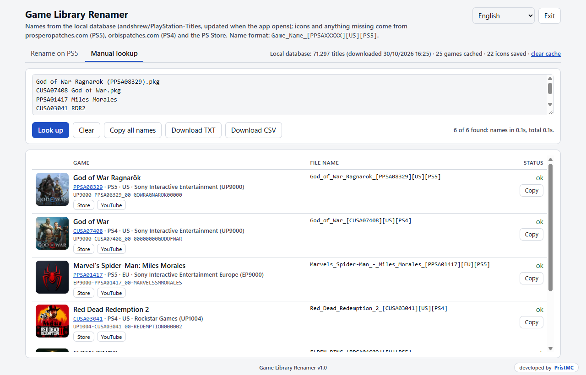

# Game Library Renamer

Rename the game files and folders on your PS5 (or any FTP/SFTP server) to clean, readable names —
automatically, from the PS4/PS5 Title ID found in each name.

```
PPSA08329-app.pkg          →  God_of_War_Ragnarok_[PPSA08329][US][PS5].pkg
CUSA07408 God of War.pkg   →  God_of_War_[CUSA07408][US][PS4].pkg
```



## Features

- **Connects to your PS5 over FTP or SFTP** and reads only the root of the folders you choose
  (subfolders are never opened). Each folder shows whether it exists.
- **Finds the Title ID** (`PPSA`, `CUSA`, …) in every file/folder name and shows the game name, cover,
  platform, region, publisher and Content ID.
- **Proposes the new name** `Game_Name_[TITLEID][REGION][PS4|PS5]` (no accents or special characters,
  spaces become `_`, the file extension is kept) with a **Rename** button per game.
- **Safe renaming**: never overwrites an existing item, detects two items that would get the same name,
  and moves the already correct ones ("NAME OK") to the end of the list.
- **Fast**: game names come from a local database of ~71,000 titles
  ([andshrew/PlayStation-Titles](https://github.com/andshrew/PlayStation-Titles)), downloaded when the app
  starts and only when it changes. Covers and publisher names come from
  [prosperopatches.com](https://prosperopatches.com) (PS5), [orbispatches.com](https://orbispatches.com)
  (PS4) and the PS Store, and are cached on disk.
- **Manual lookup** tab: paste codes or file names, copy the new names, or export TXT/CSV.
- **Store** and **YouTube** buttons for each game.
- English, Português (BR) and Español.
- Runs in its own window (no browser tabs) and closes completely when the window is closed.

## Install

1. Download `GameLibraryRenamer_<version>_Setup.exe` from the [Releases](../../releases) page.
2. Run it. No administrator rights are needed (it installs to `%LOCALAPPDATA%\Programs\Game Library Renamer`).
   Windows SmartScreen may warn because the installer is not code-signed: click **More info → Run anyway**.

When uninstalling you can choose whether to also delete your settings and cached data.

## Using it with a PS5

1. Start an FTP payload on the console. The default settings match
   [ftpsrv](https://github.com/ps5-payload-dev/ftpsrv), the most used one: **FTP, port 2121, no user,
   no password**. The etaHEN FTP uses port **1337**.
2. In the app, enter the PS5 IP address, click **Save** and **Connect**.
3. Add or remove folders right in the app (defaults: `/data/homebrew/` and `/mnt/ext0/homebrew/`).
4. Click **Rename** on each game you want to rename.

## Settings file

`GameLibraryRenamer.ini`, next to the program (**Edit INI** opens it in Notepad, **Reload INI** reads it again):

```ini
[app]
language = en

[ps5]
protocol = ftp
host = 192.168.0.10
port = 2121
user =
password =

[folders]
folder1 = /data/homebrew/
folder2 = /mnt/ext0/homebrew/
```

> The password is stored as plain text in this file.

## Run from source

Requires Windows and Python 3.12+.

```bat
pip install paramiko
python app_ps5.py
```

Command-line lookup without the UI: `python consulta_ps5.py PPSA08329 CUSA07408`.

### Build the installer

Requires `pip install pyinstaller pillow paramiko` and [Inno Setup 6](https://jrsoftware.org/isinfo.php).
Set `VERSAO` in `ftp_ps5.py`, then run:

```powershell
powershell -ExecutionPolicy Bypass -File instalador\gerar_instalador.ps1
```

The installer is written to `instalador\saida\`.

## Credits

- Title database: [andshrew/PlayStation-Titles](https://github.com/andshrew/PlayStation-Titles) (MIT).
- Game pages and covers: [prosperopatches.com](https://prosperopatches.com) and [orbispatches.com](https://orbispatches.com).
- FTP payload: [ps5-payload-dev/ftpsrv](https://github.com/ps5-payload-dev/ftpsrv).

This project is not affiliated with Sony Interactive Entertainment. "PlayStation", "PS4" and "PS5" are
trademarks of Sony Interactive Entertainment Inc.

## License

[MIT](LICENSE) © PristMC
